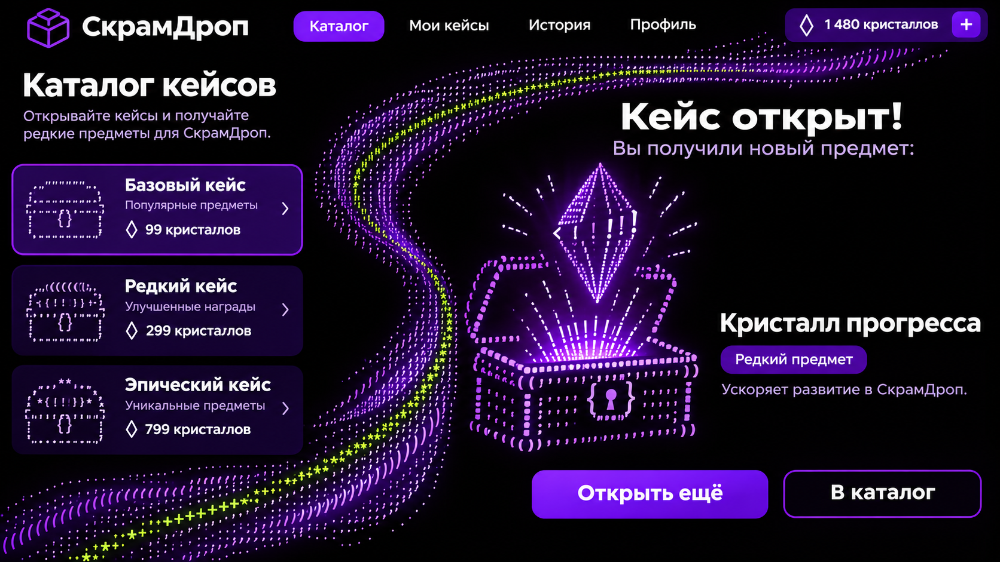
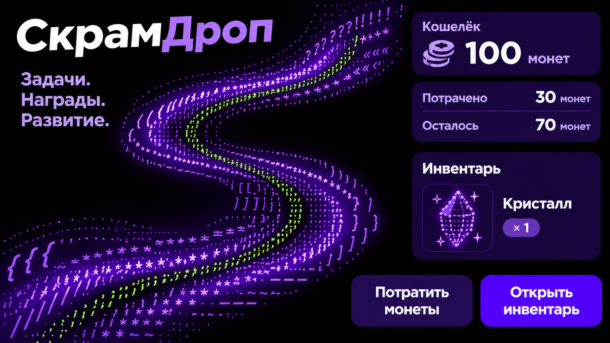
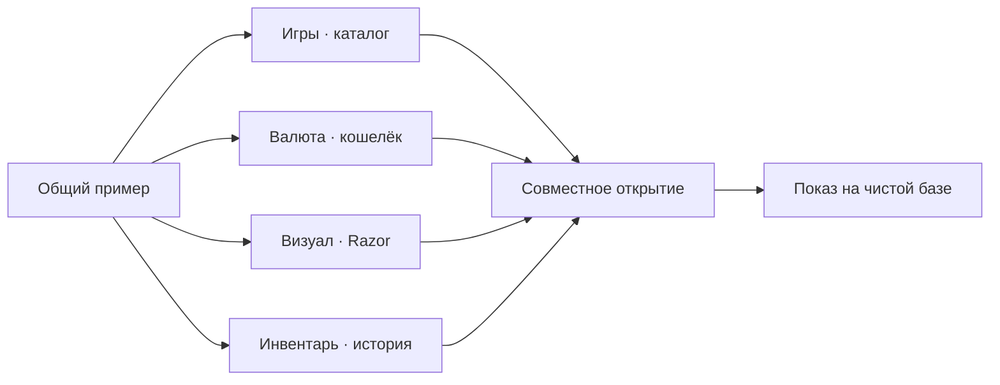

# Спринт 1 · От выбора кейса до предмета в коллекции

**Цель на 10 рабочих дней.** Игрок выбирает кейс, видит цену и возможные награды, тратит монеты и находит выигрыш в инвентаре и истории. Итоговое приложение планируется на ASP.NET Core MVC, Razor и SQLite. [Интерактивный HTML-эскиз](../prototype/index.html) можно открыть локально в браузере.

## Кто с чего начинает

| Участник | Ветка и карточка задач | Что можно делать сразу |
|---|---|---|
| HoMaX | [Игры и кейсы](tracks/games.md) · `feature/games` | Список кейсов и выбор награды в памяти |
| DozFire-College | [Виртуальная валюта](tracks/currency.md) · `feature/currency` | Списание в отдельной тестовой SQLite |
| Efka | [Визуал и интерфейс](tracks/visual.md) · `feature/visual` | Экраны на статических данных прототипа |
| stupiqplonde | [Инвентарь и история](tracks/inventory.md) · `feature/inventory` | Журнал на заранее заполненных событиях |

## Общий пример данных

Игрок `demo` получает 100 монет. Кейс `orbit` стоит 30 и содержит обычную звезду и редкий кристалл. Кейс `leaf` стоит 30 и содержит обычный лист и редкий кристалл. Для проверки совместимости подставьте кристалл вручную.

| Момент | Вход | Ожидаемый результат |
|---|---|---|
| Каталог | GET /cases | Два кейса с ценой, названиями и редкостью предметов |
| Открытие | POST /cases/orbit/open, игрок demo, уникальный requestId | Один openingId, itemId = crystal в контрольном примере, баланс 70 |
| Инвентарь | GET /inventory для demo | Кристалл × 1 |
| История | GET /history для demo | Одна строка: время, кейс, предмет, стоимость |
| Отказ | Баланс 29, цена 30 | Сообщение «Недостаточно монет», баланс 29, прежний журнал |
| Повтор того же запроса | Тот же requestId и игрок | Первоначальный результат, одно списание и одна награда |

Для переноса между модулями событие содержит `openingId, requestId, playerId, caseId, itemId, price, openedAtUtc`. Владелец игр открывает транзакцию, передаёт одно соединение и транзакцию кошельку и инвентарю, завершает её после обеих записей. Уникальная пара игрока и requestId защищает повтор операции.

## Как проходит спринт

| Дни | Результат этапа | Встреча команды |
|---|---|---|
| 1–2 | Четыре независимых примера по карточкам. HoMaX создаёт общий MVC-проект, ведёт Program.cs и подключение модулей. | Планирование 30 минут. Каждый показывает пример входа и выхода своей части. |
| 3–5 | Первая версия каждой части на своих данных. SQL кошелька и истории хранится в отдельных файлах модулей. | Каждый день 10 минут: что готово, что мешает. День 5 — обмен результатами. |
| 6–8 | Pull request из каждой ветки в main. Сначала независимые модули, затем подключение в общем проекте. | Игры и кошелёк проверяют списание. Визуал и инвентарь сверяют отображение истории. |
| 9–10 | Сборка и демонстрация на чистой тестовой базе. | День 9 — исправления. День 10 — показ, ретроспектива и одна договорённость на следующий спринт. |

Каждый ведёт одну задачу в работе. Статусы: **К выполнению → В работе → На проверке → Готово**. Для проверки PR укажите шаги и ожидаемый результат. По кругу HoMaX проверяет кошелёк, DozFire-College — инвентарь, stupiqplonde — визуал, Efka — игры. Если соседний модуль ещё в работе, продолжайте с общим примером выше. Общие файлы проекта редактирует HoMaX; авторы направлений передают ему строки подключения своих модулей.

**Готовность спринта.** Проект собирается; три открытия за 90 оставляют 10 монет, четвёртое отклоняется. История содержит три события, сумма количеств в инвентаре равна трём. Данные сохраняются после перезапуска. Команда показывает сценарий на телефоне и компьютере.

**Оформление.** Чёрный фон, обычные читаемые русские подписи, тени #0C0032 и #190061, насыщенный фиолетовый #240090 и #3500D3, светящиеся фиолетовые края и узкий зелёный акцент внутри волны. Декор и предметы набраны символами. [Запросы для эскизов ImageGen](sketches/prompts.md).

